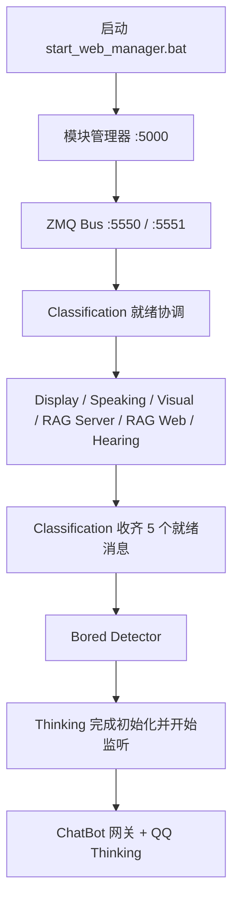

# 项目启动说明（纯 Python 主链路）

当前运行链路使用根目录的 Python 代码。

## QQ / 纯 ChatBot

NapCat 由 Docker 隔离运行。首次启动：

```bash
python -m pip install -r requirements-chatbot.txt
python napcat.py up
python napcat.py webui
```

首次需在 WebUI 扫码，令牌位于 `deploy/napcat/.env`；初始化命令会生成随机令牌与持久化目录，并把连接配置补入根 `.env`。已有配置不会被覆盖。设置 `.env` 中的 `DEEPSEEK_API_KEY` 和 `BINES_OWNER_QQ_IDS=主人QQ号`，再启动：

```bash
python start_modules.py --profile chatbot
```

此模式只运行 ChatBot 网关和 QQ Thinking，记忆直接使用共享 SQLite，不启动 ZMQ、摄像头、麦克风、语音、屏幕或独立 RAG 服务。Ctrl+C 会结束两个进程。完整桌面模式使用 `python start_modules.py --profile full`，Web 管理器保留原入口。

旧主人 JSON 记忆可无损导入，原文件保留，重复执行不会重复写入：

```bash
python -m chatBot.migrate_memory
```

主人私聊与桌面共享记忆；其他私聊独立；群聊只能读取当前群公开记录，个人状态按群和用户分别保存。默认只回复私聊、群内 @机器人和引用机器人消息；`BINES_QQ_GROUP_REPLY=all` 可启用群内全部消息回复。通知、撤回和请求保留原事件，不自动审批。

`python napcat.py status|logs|down|update` 管理容器；`down` 保留数据。媒体宿主目录 `deploy/napcat/data/media` 在容器中为 `/bines-media`。完整能力使用 `napcat_discover` + `napcat_call`，支持所有运行中 NapCat action；`napcat_events` 查看请求原始 flag，`napcat_operation` 查询发送回执。结果不确定的写操作不自动重发。

常用消息使用 `napcat_send`：支持私聊、群聊、`reply_to` 引用回复，以及 `text`、`image`、`face`、`mface` 消息段。图文要放在同一个消息段数组中一次发送，成功返回一个 message_id；自定义图片表情使用 `image.data.sub_type=1`。多选消息使用 `napcat_forward(message_ids=[...])` 按列表顺序合并转发，成功后不会再自动补发重复文字。

普通用户可发送当前会话的图片、base64 图片或 `deploy/napcat/data/media/public/` 公开素材（容器路径 `/bines-media/public/`）；只能引用和转发当前会话中未撤回的消息。本机与主人私聊可按请求跨会话发送。上述参数已对照 [NapCatDocs 4.18.38](https://github.com/NapNeko/NapCatDocs/blob/main/src/api/4.18.38/openapi.json) 和 NapCat 消息处理源码核验；接口可调用不代表每个 QQ 账号、客户端或所有 API 已完成实机验证。

NapCat MCP：`python -m chatBot.mcp_server`，通过 stdio 连接；先启动网关。其他 MCP 将 `mcp.servers.example.json` 复制为 `mcp.servers.json`，启用相应配置，再用 `mcp_discover/mcp_call` 发现和调用。只有本机与主人私聊可调用外部 MCP。Ark 现有适配继续保留。

协议模拟回归（不连接真实 QQ）：`python -m unittest verification.napcat_integration -v`。当前开发机未安装 Docker、未登录 QQ，真实部署与 QQ API 尚需实机核验。

## 日常启动

1. 需要 QQ 功能时先执行 `python napcat.py up`。语音播报用的 GPT-SoVITS：在 `.env` 设置 `GPT_SOVITS_DIR`（整合包目录，需含 `runtime\python.exe` 和 `api_v2.py`）后，管理器会把它作为 **GPT-SoVITS** 服务随“启动所有服务”一起启动，端口取自 `BINES_TTS_URL`（默认 9880），模型权重沿用整合包里的 `GPT_SoVITS/configs/tts_infer.yaml`。未设置时需自行启动。
2. 双击根目录的 `start_web_manager.bat`，等待终端提示管理页就绪。
3. 打开 `http://127.0.0.1:5000`，点击“启动所有服务”。
4. 需要管理记忆库时，服务列表中的 **RAG Web** 会随全部服务启动，可访问 `http://127.0.0.1:5001`。

停止时在管理页点击“停止所有服务”，再关闭管理器。日志和服务状态都在管理页查看。

## 启动顺序

服务定义集中在根目录 `process_registry.py`。Web 管理器按列表顺序启动：



Thinking 会等 Display、Speaking、Visual、RAG Server 和 Hearing 上报就绪后才初始化记忆服务并正式监听。Hearing 首次运行可能下载 ASR 和标点模型；模型加载时间取决于网络与机器性能，等待期间日志不一定立即显示“监听麦克风”。

备用控制台模式：

```powershell
python start_modules.py --console
```

控制台模式会为模块分别打开窗口；关闭启动器不会停止这些模块，需要逐个关闭服务窗口。

## Python 环境

管理器通过 `thingking/thinking_venv` 启动。各服务沿用自己的依赖环境：

- `server/server_venv`：ZMQ Bus、Classification、Display、Speaking、ChatBot
- `visual/envs/runtime_venv`：Visual
- `hearing/envs/runtime_venv`：Hearing
- `thingking/thinking_venv`：RAG Server、RAG Web、Bored Detector、Thinking

启动器不会创建虚拟环境或安装依赖。若模块日志显示解释器不存在或依赖导入失败，先检查对应环境和该模块的 requirements 文件。

## 端口与通信

管理器把每个服务（连同 venv 启动器派生的真正解释器）放进 Windows Job Object：在页面上停止服务、关闭管理器窗口或管理器崩溃时，整棵进程树都会被系统结束，不会再留下占端口的残留进程。

启动前管理器会检查服务端口；若已被占用，该服务不会启动，并提示占用者 PID。管理器不会终止这些进程，需要手动结束（以管理员身份启动的残留进程需在管理员终端里执行 `taskkill /PID <pid> /T /F`）。管理器自身端口被占用时 `start_web_manager.bat` 会直接退出，说明已有一个管理器在运行。

所有项目内端口集中在根目录 `config.py` 的 `ZMQ_PORTS` 和 `HTTP_PORTS`，可通过 `BINES_*_PORT` 环境变量覆盖。PUB/SUB 消息统一经过一个本地总线，topic 区分消息类型；REQ/REP 只用于需要请求响应的服务。

- `5000`：模块管理 Web 页面
- `5001`：RAG 记忆 Web 页面
- `5550`：PUB/SUB 总线发布入口
- `5551`：PUB/SUB 总线订阅出口
- `5557`：Visual 请求响应
- `5560`：RAG Server 请求响应
- `5570`：模块就绪通知
- `5571`：Classification 到 Thinking 的启动握手
- `9880`：GPT-SoVITS TTS HTTP 接口（由 `BINES_TTS_URL` 决定）

GPT-SoVITS 是外部服务；NapCat 由 `napcat.py` 管理 Docker 生命周期。NapCat 使用 `BINES_NAPCAT_WS_URL` 配置 WebSocket 地址，鉴权令牌从 `BINES_NAPCAT_ACCESS_TOKEN` 读取。网关默认 `6102`、WebUI 默认 `6099`。

## 模型与配置

- 文本对话、总结、记忆维护、无聊检测和音乐相关文本任务共用 `DEEPSEEK_API_KEY`、`DEEPSEEK_BASE_URL`、`DEEPSEEK_MODEL`。`deepseek-flash` 默认会先推理再回答，项目通过 `DEEPSEEK_THINKING`（默认 `disabled`）统一关闭，避免短回复类调用被推理耗尽 token 而返回空内容。
- QQ 图片、屏幕、相册、摄像头场景和视频帧统一使用 DeepSeek 视觉模型，默认 `DEEPSEEK_VISION_MODEL=deepseek-flash`，与文本共用 `DEEPSEEK_API_KEY`。Visual 人脸身份识别仍使用 `VISUAL_FACE_MODEL`（默认 `buffalo_l`）；ASR/TTS 保持原方案。
- `browser_search` 调用 DeepSeek Search API，`web_fetch` 调用 Fetch API，返回来源 URL、标题、日期/摘要或 Markdown 正文。桌面与纯 ChatBot 均可调用，无需 Selenium 或启动 Chrome。旧浏览器实现保留为未注册的兼容参考，失败时不自动回退。
- 技能说明放在 `skills/**/SKILL.md`，Python 动作由 Thinking 的 `SkillRunner` 调度；管理页“本地技能”可启停动作。
- 在项目根目录 `.env` 配置凭据、模型、QQ 身份和连接信息，模板见 `.env.example`。`config.py` 仅保留默认值加载逻辑。QQ、桌面、NapCat 部署、记忆和 MCP 入口均自动加载 `.env`，不受启动时工作目录影响。
- **`.env` 中的值优先于同名系统环境变量**，包括显式空值；文件未指定的项才读取进程环境或代码默认值。修改后重启服务。支持单行引号、行尾注释、`export KEY=value` 和 `${NAME}` 引用；`BINES_ENV_FILE` 可指定独立配置文件用于测试或多实例。示例：

```ini
DEEPSEEK_API_KEY=sk-...
DEEPSEEK_MODEL=deepseek-flash
DEEPSEEK_VISION_MODEL=deepseek-flash
BINES_OWNER_QQ_IDS=你的QQ号
# 按需填写
BINES_NAPCAT_ACCESS_TOKEN=
MOMENTS_UID=
MOMENTS_TOKEN=
TOGGLE_STATUS_TOKEN=
```

不要把真实密钥提交到仓库。

截至 2026-10-20，官方 [Vision 文档](https://api-docs.deepseek.com/guides/vision/) 明确 `deepseek-flash` 支持图文输入；[Search / Fetch 文档](https://api-docs.deepseek.com/guides/search/) 提供 `/v1/tools/search`、`/v1/tools/fetch`，使用同一 API Key。本项目使用独立搜索接口，避免依赖仅 V4 Pro 支持的 Responses `web_search` 工具。Search / Fetch 按请求单独计费，参考官方文档。
