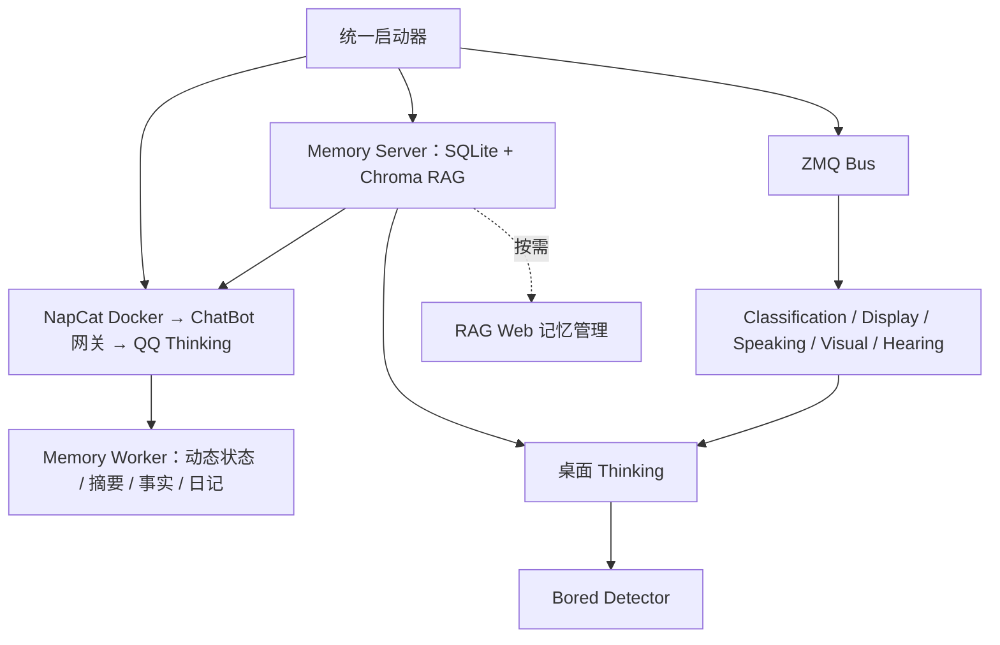

# 项目启动说明（Docker 优先，宿主机兜底）

QQ 与记忆链路默认使用 Docker；桌面显示、视觉、听觉和桌面 Thinking 仍在宿主机运行。

## 一键安装

首次运行 `python install.py` 安装全部 6 组环境并构建 Docker launcher 镜像；只使用 QQ 可运行 `python install.py --profile chatbot`。需要同时构建 Docker thinking 镜像时加 `--docker-full`。Windows 可双击 `install.bat`，macOS 可双击 `install.command`。

安装器自动寻找或下载兼容 Python、创建/复用虚拟环境、安装并检查依赖，保留原 `.env` 和记忆。macOS/Windows 缺少 Docker Desktop 时会自动下载安装并触发一次系统授权，首次协议仍由用户在 Docker 窗口确认；使用外部 NapCat 时可加 `--skip-docker`。系统音视频库可加 `--system` 通过已有包管理器安装。部分失败可用 `--only visual hearing` 单独重试；完整说明见 [依赖安装](docs/INSTALL.md)。

## 一个启动入口

```bash
python bines.py
```

默认使用 Docker 启动 QQ 链路和记忆服务；完整模式再启动宿主机的桌面模块并打开管理页。只运行 QQ：

```bash
python bines.py --profile chatbot
```

强制回到纯宿主机模式（不启动 Docker）：

```bash
python bines.py --host
python bines.py --host --profile chatbot
```

`python bines.py --profile chatbot` 会启动 NapCat、Memory Server、ChatBot、QQ Thinking、Memory Worker，只有源码内容或构建参数变化时才构建镜像。Ctrl+C 删除本次启动的容器及其日志，清理 Bines 旧镜像和专用构建缓存，保留记忆、登录数据、模型和当前镜像。首次登录二维码在容器日志中：

```bash
docker compose --env-file deploy/napcat/.env -f deploy/docker/compose.yaml logs -f napcat
```

已有外部 NapCat 时使用 `--external-napcat`，会走宿主机模式。仅打开管理器、不自动启动服务使用 `--manager-only`。

按 Ctrl+C 会清理本次启动的宿主服务和容器；已经在外部运行的容器不受影响。强制结束进程可能跳过退出清理，此时运行 `python bines.py --docker-down` 可停止并清理整个 Bines Docker 项目，同时保留记忆和当前镜像。每个容器的 Docker 日志按 10 MB × 3 个文件轮转。Windows Docker/WSL 虚拟磁盘删除文件后可能不会立即缩小，Docker 可复用其中释放的空间；这和容器未删除是两回事。

单独在管理页启动 Thinking 会自动补启其依赖，停止前置服务会先停止依赖它的服务。状态显示“启动中 / 已就绪 / 依赖阻塞 / 失败”，失败原因和日志保留。

Memory Server 在两种模式都会启动并统一持有 SQLite 和 Chroma 向量索引，ChatBot 通过网关使用同一套 RAG；只有 `--host` 且本机 Memory Server 未运行时才退回网关内置的词面检索。完整模式另有 RAG Web。唱歌流水线收到唱歌请求时才运行。

## QQ / 纯 ChatBot

NapCat 由 Docker 隔离运行。首次启动：

```bash
python install.py --profile chatbot
```

设置 `.env` 中的 `DEEPSEEK_API_KEY` 和 `BINES_OWNER_QQ_IDS=主人QQ号`，再启动：

```bash
python bines.py --profile chatbot
```

默认 Docker 模式运行 NapCat、Memory Server、ChatBot、QQ Thinking 和独立 Memory Worker。Memory Server 使用 SQLite、Chroma 向量检索和中文关键词匹配，QQ Thinking 经鉴权 HTTP 网关读写同一套记忆；不会启动桌面摄像头、麦克风、语音或屏幕模块。Memory Worker 负责动态状态、摘要、长期事实和日记，避免占用对话进程。`--host --profile chatbot` 且没有 Memory Server 时，才使用网关内置词面检索。首次登录二维码打印在 `python3 napcat.py logs` 的容器日志中；`http://127.0.0.1:6099` 是需要 WebUI token 的管理页，可用 `python3 napcat.py webui` 自动携带 token 打开。令牌位于 `deploy/napcat/.env`，已有配置保持原样。旧 `start_modules.py` 仍兼容同样参数。

停止服务后，旧 JSON 和 Chroma 记忆可导入新版库；原文件保留，重复执行不会重复写入：

```bash
python -m chatBot.migrate_memory
```

主人私聊与桌面共享记忆；其他私聊独立；群聊只能读取当前群公开记录，个人状态按群和用户分别保存。默认只回复私聊、群内 @机器人和引用机器人消息；`BINES_QQ_GROUP_REPLY=all` 可启用群内全部消息回复。通知、撤回和请求保留原事件，不自动审批。

`python napcat.py status|logs|down|update` 管理容器；`down` 保留数据。媒体宿主目录 `deploy/napcat/data/media` 在容器中为 `/bines-media`。完整能力使用 `napcat_discover` + `napcat_call`，支持所有运行中 NapCat action；`napcat_events` 查看请求原始 flag，`napcat_operation` 查询发送回执。结果不确定的写操作不自动重发。

全部 API 暴露检查：本机与主人私聊的技能提示词包含 NapCatDocs 4.18.38 的 **178 个 API 索引**；`napcat_discover()` 返回完整目录，指定 `action` 返回参数和响应 schema。项目附带完整官方文档，即使缺少 WebUI token 也可以查询。`napcat_catalog()` 返回文档数量、当前身份允许数量、连接状态和运行时目录差异；`runtime_supported=null` 表示未确认，不能当作 QQ 已支持。配置 WebUI token 后自动合并运行时新增接口。普通 QQ 会话继续限制为当前会话的 14 个 API。

NapCat MCP 列出 **178 个独立 API 工具及 4 个通用工具**，每个独立工具的 `params` 为该 API 的参数 schema；以点号开头的 API 自动映射为合法 MCP 工具名，原始 action 保存在工具 `_meta.napcat_action`。官方目录可使用 `python -m chatBot.update_catalog 版本号` 更新，生成来源与内容哈希 manifest。更新后重启进程使模型索引和目录缓存生效。

常用消息使用 `napcat_send`：支持私聊、群聊、`reply_to` 引用回复，以及 `text`、`image`、`face`、`mface` 消息段。图文要放在同一个消息段数组中一次发送，成功返回一个 message_id；自定义图片表情使用 `image.data.sub_type=1`。收藏表情可用 `napcat_send_custom_face(index=0, text="正文")` 携带文本；只发送媒体后仍可补充最终文字，已经发送的相同正文不会重复发送。多选消息使用 `napcat_forward(message_ids=[...])` 按列表顺序合并转发，成功后不会再自动补发重复文字。

普通用户可发送当前会话的图片、base64 图片或 `deploy/napcat/data/media/public/` 公开素材（容器路径 `/bines-media/public/`）；只能引用和转发当前会话中未撤回的消息。本机与主人私聊可按请求跨会话发送。上述参数已对照 [NapCatDocs 4.18.38](https://github.com/NapNeko/NapCatDocs/blob/main/src/api/4.18.38/openapi.json) 和 NapCat 消息处理源码核验；接口可调用不代表每个 QQ 账号、客户端或所有 API 已完成实机验证。

NapCat MCP：`python -m chatBot.mcp_server`，通过 stdio 连接；先启动网关。其他 MCP 将 `mcp.servers.example.json` 复制为 `mcp.servers.json`，启用相应配置，再用 `mcp_discover/mcp_call` 发现和调用。只有本机与主人私聊可调用外部 MCP。Ark 现有适配继续保留。

协议模拟回归（不连接真实 QQ）：`python -m unittest verification.napcat_integration verification.napcat_api_exposure -v`。暴露检查遍历全部 178 个 API，验证模型索引、Skill 调度、网关参数传递、MCP schema 和真实 stdio 客户端。该检查不证明 QQ 业务执行成功，真实部署与 QQ API 尚需实机核验。

## 日常启动

1. 运行 `python bines.py`，或双击本机启动脚本；服务会自动启动。
2. 管理页 `http://127.0.0.1:5000` 展示依赖就绪状态与失败原因，无需记忆服务启动顺序。
3. 需要管理记忆时，在服务列表中单独启动 **RAG Web**，访问 `http://127.0.0.1:5001`。
4. 完整模式的本机 GPT-SoVITS 可通过 `.env` 的 `GPT_SOVITS_DIR` 自动启动；它缺失时不会被伪装成已配置服务。使用远程 TTS 时配置 `BINES_TTS_URL`。

停止时在管理页点击“停止所有服务”，再关闭管理器。日志和服务状态都在管理页查看。

## 启动顺序

服务定义集中在根目录 `process_registry.py`。管理器按依赖启动：



依赖由 `process_registry.py` 定义，执行与就绪检查由 `service_supervisor.py` 统一负责。模块标记只对本次启动 token 有效，避免把旧状态当成就绪。QQ 链路独立启动，不等待 Visual/Hearing 模型。管理方式不再使用 Classification 的一次性启动消息，Thinking 重启不会卡在旧握手上。

备用控制台模式：

```powershell
python bines.py --console
```

控制台与 Web 使用相同调度；Ctrl+C 会清理子进程。普通服务等待就绪 120 秒，Visual/Hearing/Memory Server 600 秒，可在 `.env` 用 `BINES_STARTUP_TIMEOUT` 覆盖。

## 记忆系统与人格

- 无论完整模式还是纯 QQ 模式，**RAG Server** 都独占 `thingking/memory_data/memory.db` 和 `index/`（可重建的 Chroma 索引），桌面客户端直接使用 `5560`；QQ 客户端经 ChatBot 网关转发到同一个 RAG Server。`--host --profile chatbot` 且本机没有 RAG Server 时，网关才退回内置词面检索，之后切到 RAG 会自动补建向量索引。
- QQ 原始消息、事件队列和发送回执保存在独立的 `gateway.db`，提交成功后同步到记忆库。启动时自动识别旧 NapCat `memory.db` 的表结构并迁移到 `gateway.db`，不会覆盖新版库；同步可恢复且去重。
- 本机与 `BINES_OWNER_QQ_IDS` 显式绑定的主人私聊共享 owner 记忆和状态；其他私聊按机器人账号与用户隔离，群聊按账号与群号隔离，个人状态再按发言人区分。群管理员角色不赋予主人身份。
- 动态状态按真实新消息由独立 Memory Worker 在后台更新，不再等到累计 40 条消息触发摘要。普通问候、记忆查询和假设不改变好感度；明确情感事件才使用小幅增量。状态任务完成和写库在同一事务中提交，重试不重复加分；消息撤回或同消息手动更新后取消自动任务。群聊个人状态按群和用户保存，不改主人私聊状态。
- 摘要、长期事实提取和每日日记也由 Memory Worker 统一处理所有渠道，任务状态记在 SQLite，失败会重试。后台更新不阻塞 QQ 回复，刚发生的变化可能要等任务完成后才能读到；每次状态任务会调用一次文本模型，可用 `BINES_MEMORY_STATE_UPDATES=false` 关闭自动更新。
- 当前动态状态（含好感度数值）和用户画像直接注入提示词；原永久画像不再只取前 8 条。旧回忆采用向量与中文关键词联合排序，限制旧重要度 100 的过度加权。上下文不够时模型可以调用 `search_memory` 主动查询，权限边界与自动召回一致。
- 人格只在 `thingking/persona/persona.yaml` 中维护，修改后运行 `python thingking/persona/render_doc.py` 更新 `PERSONA.md`。
- 维护命令：`python thingking/memory_admin.py stats | verify | rebuild-index`。离线迁移、校验或重建前停止 RAG Server、ChatBot、QQ Thinking 及其他记忆客户端。迁移快照放在 `legacy_backup/`；`restore-legacy <备份目录>` 可恢复旧文件。
- 测试：`python -m unittest discover -s thingking/tests`；QQ 回归见上面的 verification 命令。

## Python 环境

安装器与启动器共用 `runtime_environments.py` 中的环境路径；`python bines.py` 自动进入 `.venv`：

- `.venv`：管理器、ChatBot、QQ Thinking、Memory Worker（纯 QQ 安装只创建这一组）
- `server/server_venv`：ZMQ Bus、Classification、Display、Speaking
- `visual/envs/runtime_venv`：Visual
- `hearing/envs/runtime_venv`：Hearing
- `thingking/thinking_venv`：RAG Server、按需 RAG Web、Bored Detector、桌面 Thinking、实时屏幕
- `singing/singing_venv`：唱歌分离与混音；so-vits-svc 换声仍使用整合包环境

启动器不在运行时安装依赖；安装和验证统一使用 `python install.py` / `python install.py --check`。兼容环境会复用，不兼容的已有目录会明确报错，安装器不会自动删除。

## 端口与通信

管理器把每个服务（连同 venv 启动器派生的真正解释器）放进 Windows Job Object：在页面上停止服务、关闭管理器窗口或管理器崩溃时，整棵进程树都会被系统结束，不会再留下占端口的残留进程。

启动前管理器会检查服务端口；若已被占用，该服务不会启动，并提示占用者 PID。管理器不会终止这些进程，需要手动结束（以管理员身份启动的残留进程需在管理员终端里执行 `taskkill /PID <pid> /T /F`）。管理器自身端口被占用时 `start_web_manager.bat` 会直接退出，说明已有一个管理器在运行。

所有项目内端口集中在根目录 `config.py` 的 `ZMQ_PORTS` 和 `HTTP_PORTS`，可通过 `BINES_*_PORT` 环境变量覆盖。PUB/SUB 消息统一经过一个本地总线，topic 区分消息类型；REQ/REP 只用于需要请求响应的服务。

- `5000`：模块管理 Web 页面
- `5001`：RAG 记忆 Web 页面
- `5550`：PUB/SUB 总线发布入口
- `5551`：PUB/SUB 总线订阅出口
- `5557`：Visual 请求响应
- `5560`：完整模式 Memory Server 请求响应
- `5570 / 5571`：兼容旧直接启动的就绪/握手端口；统一启动器不使用
- `9880`：GPT-SoVITS TTS HTTP 接口（由 `BINES_TTS_URL` 决定）

GPT-SoVITS 是外部服务；NapCat 由 `napcat.py` 管理 Docker 生命周期。NapCat 使用 `BINES_NAPCAT_WS_URL` 配置 WebSocket 地址，鉴权令牌从 `BINES_NAPCAT_ACCESS_TOKEN` 读取。网关默认 `6102`、WebUI 默认 `6099`。

## 模型与配置

- 文本对话、总结、记忆维护、无聊检测和音乐相关文本任务共用 `DEEPSEEK_API_KEY`、`DEEPSEEK_BASE_URL`、`DEEPSEEK_MODEL`。`deepseek-flash` 默认会先推理再回答，项目通过 `DEEPSEEK_THINKING`（默认 `disabled`）统一关闭，避免短回复类调用被推理耗尽 token 而返回空内容。
- QQ 图片、屏幕、相册、摄像头场景和视频帧统一使用 DeepSeek 视觉模型，默认 `DEEPSEEK_VISION_MODEL=deepseek-flash`，与文本共用 `DEEPSEEK_API_KEY`。Visual 人脸身份识别仍使用 `VISUAL_FACE_MODEL`（默认 `buffalo_l`）；ASR/TTS 保持原方案。
- `browser_search` 调用 DeepSeek Search API，`web_fetch` 调用 Fetch API，返回来源 URL、标题、日期/摘要或 Markdown 正文。桌面与纯 ChatBot 均可调用，无需 Selenium 或启动 Chrome。旧浏览器实现保留为未注册的兼容参考，失败时不自动回退。
- 技能说明放在 `skills/**/SKILL.md`，Python 动作由 Thinking 的 `SkillRunner` 调度；管理页“本地技能”可启停动作。
- 在项目根目录 `.env` 配置凭据、模型、QQ 身份和连接信息，模板见 `.env.example`。`config.py` 仅保留默认值加载逻辑。QQ、桌面、NapCat 部署、记忆和 MCP 入口均自动加载 `.env`，不受启动时工作目录影响。
- **`.env` 中的值优先于同名系统环境变量**，包括显式空值；文件未指定的项才读取进程环境或代码默认值。修改后重启服务。支持单行引号、行尾注释、`export KEY=value` 和 `${NAME}` 引用；`BINES_ENV_FILE` 可指定独立配置文件用于测试或多实例。示例：

```ini
DEEPSEEK_API_KEY=sk-...
DEEPSEEK_MODEL=deepseek-flash
DEEPSEEK_VISION_MODEL=deepseek-flash
BINES_OWNER_QQ_IDS=你的QQ号
# 按需填写
BINES_NAPCAT_ACCESS_TOKEN=
MOMENTS_UID=
MOMENTS_TOKEN=
TOGGLE_STATUS_TOKEN=
```

不要把真实密钥提交到仓库。

截至 2026-10-20，官方 [Vision 文档](https://api-docs.deepseek.com/guides/vision/) 明确 `deepseek-flash` 支持图文输入；[Search / Fetch 文档](https://api-docs.deepseek.com/guides/search/) 提供 `/v1/tools/search`、`/v1/tools/fetch`，使用同一 API Key。本项目使用独立搜索接口，避免依赖仅 V4 Pro 支持的 Responses `web_search` 工具。Search / Fetch 按请求单独计费，参考官方文档。
