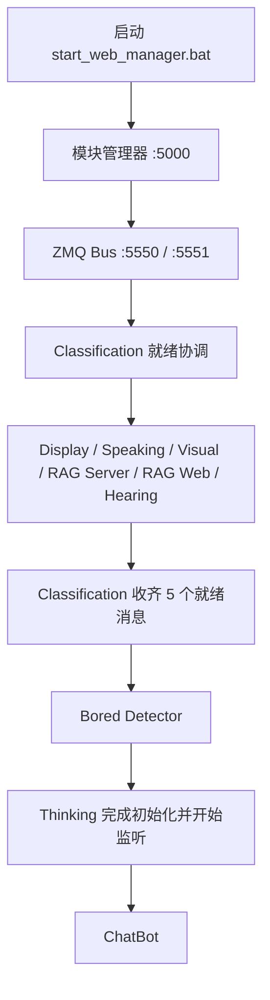

# 项目启动说明（纯 Python 主链路）

当前运行链路使用根目录的 Python 代码。

## 日常启动

1. 需要 QQ 功能时先启动 NapCat WebSocket。语音播报用的 GPT-SoVITS：在 `.env` 设置 `GPT_SOVITS_DIR`（整合包目录，需含 `runtime\python.exe` 和 `api_v2.py`）后，管理器会把它作为 **GPT-SoVITS** 服务随“启动所有服务”一起启动，端口取自 `BINES_TTS_URL`（默认 9880），模型权重沿用整合包里的 `GPT_SoVITS/configs/tts_infer.yaml`。未设置时需自行启动。
2. 双击根目录的 `start_web_manager.bat`，等待终端提示管理页就绪。
3. 打开 `http://127.0.0.1:5000`，点击“启动所有服务”。
4. 需要管理记忆库时，服务列表中的 **RAG Web**（记忆管理页）会随全部服务启动，可访问 `http://127.0.0.1:5001`。

停止时在管理页点击“停止所有服务”，再关闭管理器。日志和服务状态都在管理页查看。

## 启动顺序

服务定义集中在根目录 `process_registry.py`。Web 管理器按列表顺序启动：



Thinking 会等 Display、Speaking、Visual、RAG Server 和 Hearing 上报就绪后才初始化记忆服务并正式监听。Hearing 首次运行可能下载 ASR 和标点模型；模型加载时间取决于网络与机器性能，等待期间日志不一定立即显示“监听麦克风”。

备用控制台模式：

```powershell
python start_modules.py --console
```

控制台模式会为模块分别打开窗口；关闭启动器不会停止这些模块，需要逐个关闭服务窗口。

## 记忆系统与人格

- 服务列表里的 **RAG Server** 进程就是 Memory Server：它独占 `thingking/memory_data/memory.db`（SQLite，唯一事实源）和 `thingking/memory_data/index/`（Chroma 向量索引，可随时从 SQLite 重建）。其他进程只通过 `5560` 端口的客户端读写。
- 本机对话与 NapCat 消息统一成同一种会话信封。本机和 `ADMIN_QQ_LIST`（或环境变量 `BINES_OWNER_QQ_IDS`）里的 QQ 私聊共享管理员（owner）记忆和关系状态；其他私聊、每个群聊各自独立，群聊永远看不到管理员的私人记忆。
- 情节摘要、长期事实提取和每日日记由 Thinking 里的整合任务完成，任务状态记在 SQLite 中，失败会自动重试。
- 人格只在 `thingking/persona/persona.yaml` 中维护，修改后运行 `python thingking/persona/render_doc.py` 更新 `PERSONA.md`。
- 维护命令（先在管理页停止 RAG Server、RAG Web、Thinking、Bored Detector，用 `thingking/thinking_venv` 运行）：`python thingking/memory_admin.py stats | verify | rebuild-index`。旧版记忆文件已迁移，只读备份在 `thingking/memory_data/legacy_backup/`，需要回滚时用 `memory_admin.py restore-legacy <备份目录>`。
- 测试：`cd thingking/tests` 后运行 `..\thinking_venv\Scripts\python.exe -m unittest`。

## Python 环境

管理器通过 `thingking/thinking_venv` 启动。各服务沿用自己的依赖环境：

- `server/server_venv`：ZMQ Bus、Classification、Display、Speaking、ChatBot
- `visual/envs/runtime_venv`：Visual
- `hearing/envs/runtime_venv`：Hearing
- `thingking/thinking_venv`：RAG Server、RAG Web、Bored Detector、Thinking

启动器不会创建虚拟环境或安装依赖。若模块日志显示解释器不存在或依赖导入失败，先检查对应环境和该模块的 requirements 文件。

## 端口与通信

管理器把每个服务（连同 venv 启动器派生的真正解释器）放进 Windows Job Object：在页面上停止服务、关闭管理器窗口或管理器崩溃时，整棵进程树都会被系统结束，不会再留下占端口的残留进程。

启动前管理器会检查服务端口；若已被占用，该服务不会启动，并提示占用者 PID。管理器不会终止这些进程，需要手动结束（以管理员身份启动的残留进程需在管理员终端里执行 `taskkill /PID <pid> /T /F`）。管理器自身端口被占用时 `start_web_manager.bat` 会直接退出，说明已有一个管理器在运行。

所有项目内端口集中在根目录 `config.py` 的 `ZMQ_PORTS` 和 `HTTP_PORTS`，可通过 `BINES_*_PORT` 环境变量覆盖。PUB/SUB 消息统一经过一个本地总线，topic 区分消息类型；REQ/REP 只用于需要请求响应的服务。

- `5000`：模块管理 Web 页面
- `5001`：RAG 记忆 Web 页面
- `5550`：PUB/SUB 总线发布入口
- `5551`：PUB/SUB 总线订阅出口
- `5557`：Visual 请求响应
- `5560`：Memory Server（RAG Server）请求响应
- `5570`：模块就绪通知
- `5571`：Classification 到 Thinking 的启动握手
- `9880`：GPT-SoVITS TTS HTTP 接口（由 `BINES_TTS_URL` 决定）

GPT-SoVITS 和 NapCat 是外部服务，不由本项目启动；默认地址及其他本机配置见 `config.py`。NapCat 使用 `BINES_NAPCAT_WS_URL` 配置 WebSocket 地址，鉴权令牌从 `BINES_NAPCAT_ACCESS_TOKEN` 读取。

## 模型与配置

- 文本对话、总结、记忆维护、无聊检测和音乐相关文本任务共用 `DEEPSEEK_API_KEY`、`DEEPSEEK_BASE_URL`、`DEEPSEEK_MODEL`。`deepseek-flash` 默认会先推理再回答，项目通过 `DEEPSEEK_THINKING`（默认 `disabled`）统一关闭，避免短回复类调用被推理耗尽 token 而返回空内容。
- 屏幕、相册和消息图片的视觉理解共用 DashScope 配置；Visual 人脸识别使用 `VISUAL_FACE_MODEL`（默认 `buffalo_l`）；ASR 模型及 revision 由根配置控制，TTS 通过外部 HTTP 服务提供。
- 技能说明放在 `skills/**/SKILL.md`，Python 动作由 Thinking 的 `SkillRunner` 调度；管理页“本地技能”可启停动作。
- `config.py` 被 Git 忽略，只从环境变量读取凭据。新环境可复制 `config.example.py` 为 `config.py`。
- 凭据推荐写在根目录 `.env`（已被 Git 忽略），每个服务导入配置时会自动读取；系统环境变量优先于 `.env`。示例：

```ini
DEEPSEEK_API_KEY=sk-...
DASHSCOPE_API_KEY=sk-...
# 按需填写
BINES_NAPCAT_ACCESS_TOKEN=
MOMENTS_UID=
MOMENTS_TOKEN=
TOGGLE_STATUS_TOKEN=
```

不要把真实密钥提交到仓库。

截至 2026-10-01，当前配置中的 `deepseek-flash` 是 DeepSeek 官方模型列表中的有效模型 ID；旧名称 `deepseek-chat` 和 `deepseek-reasoner` 已于 2026-07-24 停止服务。视觉模型名为 `qwen3-vl-flash`，由 `DASHSCOPE_VISION_MODEL` 配置。
