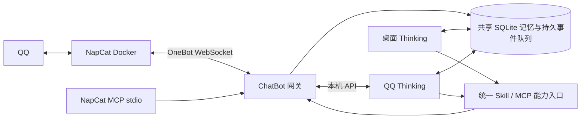

# QQ / NapCat 重构

## 目标与架构

完整桌面模式保留听觉、视觉、播报与屏幕功能。QQ 接入由独立网关负责，QQ 对话由独立 Thinking 进程处理；QQ 不进入桌面对话的全局打断槽。

纯 ChatBot 模式仅启动 ChatBot 网关与 QQ Thinking，记忆服务嵌入进程，无需 ZMQ Bus、Classification、Display、Visual、Hearing、Speaking 或 RAG 模型下载。

## 数据与身份约束

- 会话键包含机器人账号、群号和发送者 QQ ID。同名、改名、群名片均不改变身份；群主/群管理员身份与 Bines 管理权限分开。
- 主人 QQ 身份必须显式绑定。主人私聊与本机主线程共享主人记忆；群聊上下文只读取当前群的公开记录，不向群聊注入主人私聊或桌面内容。
- 其他用户的私聊、状态和长期记忆独立；不信任消息正文或客户端传入的 owner/admin/scope 标记。
- 所有消息段保留原始结构，CQ 码转换为消息段，图片、语音、文件、转发、引用和非文本消息可识别。
- API 回包与事件分离，WebSocket 收包线程不执行阻塞 API；连接和重连只有一个拥有者。
- 事件先持久化再处理，消息去重、任务租约和回复回执持久化。发送超时可能已经送达，不自动重发不确定的写操作。
- 合并只发生于同一会话，设最大等待和批次上限；繁忙时排队，不跨用户合并或打断。

## 能力入口

Skill 文档负责操作说明，能力目录负责函数及参数。NapCat 能力通过运行中服务的 schema 发现；通用 action + params 入口覆盖新扩展 API。

本地与主人可使用完整 NapCat 能力；普通 QQ 用户只能查询和操作当前会话允许的功能。群聊管理员身份不自动获得 QQ 账号凭据、跨会话历史或账号管理权限。

MCP 与文本 Skill 使用同一网关和权限判定，不分别维护功能白名单。保留现有 Skill 调用协议与 Ark 适配，并支持从配置发现其他 MCP 工具。

## Docker

使用 NapCat 官方维护的 `mlikiowa/napcat-docker` 镜像，独立网络和数据卷，宿主端口默认仅绑定回环地址。QQ 登录数据、NapCat 配置、插件与共享媒体分别持久化，不挂载项目或 Docker socket，不使用 privileged / host network。

初始化脚本生成 OneBot WebSocket 与 WebUI 配置及随机令牌；部署、日志、检查、更新和停止提供统一命令。第一次登录需要在 NapCat WebUI 扫码。

## 核验来源

- [NapCatQQ](https://github.com/NapNeko/NapCatQQ)
- [NapCat-Docker](https://github.com/NapNeko/NapCat-Docker)
- [NapCatDocs 4.18.38 OpenAPI](https://github.com/NapNeko/NapCatDocs/blob/main/src/api/4.18.38/openapi.json)：2026-10-20 核验，178 个路径。使用用户指定的 `src/api` 中最新版本目录；实际可用动作仍以所部署版本为准。
- NapCat 源码：`packages/napcat-onebot/action/router.ts`、`action/go-cqhttp/GetFriendMsgHistory.ts`、`GetGroupMsgHistory.ts`、`config/config.ts`。
- 运行中 API schema：NapCat WebUI `/api/Debug/schemas`，使用 `/api/auth/login` 返回的 Credential 认证。

## 当前环境边界

开发机未安装 Docker，且未配置 QQ 登录或模型凭据。已验证本地 HTTP 网关、真实 MCP stdio 协议、轻量启动/退出、身份隔离、并发队列、回执与历史过滤；真实 QQ 登录和 Docker 启动需在具备这些条件的环境核验。

## 实现与运维说明

- `python napcat.py up` 初始化随机令牌并启动 Docker；`python start_modules.py --profile chatbot` 仅启动网关与 QQ Thinking。完整模式新增同一 QQ Thinking，不再经 Classification 转发 QQ。
- SQLite 默认 `thingking/memory_data/memory.db`，通过 `BINES_MEMORY_DIR` 覆盖。记忆全文持久保留；近期上下文和较旧记忆检索均强制当前 scope。检索为轻量词面匹配，不声称向量语义检索。原先引用但缺失的 RAG 模块由本地 SQLite 适配恢复。
- 群公开消息按群共享，个人状态按账号 / 群 / 用户隔离。主人权限仅在本机与显式绑定主人私聊开放，群内主人也遵守群公开范围。
- 旧 JSON 用 `python -m chatBot.migrate_memory` 幂等导入主人 scope。原文件保留；旧 QQ buffer 缺少可靠账号/身份信息，不自动混入主人记忆。
- notice/request 保留原事件并可由 `napcat_events` 查询，撤回更新可见上下文；这些事件不触发聊天回复。首次收到消息会按真实会话拉取历史；图片使用 DeepSeek Flash 理解，语音、文件、转发保留原消息段并通过 NapCat 能力处理。
- 事件队列设置会话租约、最大合并等待与批次上限；单连接拥有者重连，API 分片按 NapCat `stream-action` 的 `data.type` 处理。
- 写操作先存回执，再发送，成功才写 assistant 记忆。轮次已开始后异常退出不重新调用模型；已持久化最终回复可按原 operation_id 恢复。未知结果禁止自动重复发送。失败事件的 error 和 operation 回执保留供本机核查，后续正常消息仍可处理。
- Skills 通过惰性注册表避免启动时加载桌面依赖。全部 NapCat 能力由运行时 schema + 通用 action 覆盖；外部 MCP 支持 stdio / Streamable HTTP，Ark 适配保留。
- 独立 NapCat MCP stdio 是本机能力入口，拥有完整账号权限；QQ Thinking 直接使用带真实事件身份的网关，不通过本机 MCP 提升权限。网关令牌仅保存在本机，不能暴露给聊天用户。
- Docker 数据不包含项目目录或 Docker socket；共享媒体使用 `/bines-media`。默认镜像为 `latest`，生产可在部署 `.env` 设置 `NAPCAT_IMAGE` 为已验证的 tag 或 digest。
- OneBot 不保证断线期间逐条回放。重连后的历史补充恢复可见会话上下文；完全没有后续消息的会话无法仅靠 WebSocket 恢复漏掉的触发事件。

## 消息功能专项核验

| 功能 | 实现 | 验证范围 |
| --- | --- | --- |
| 普通回复、引用回复 | `napcat_send`，`reply_to` 转为 `reply.data.id` | HTTP 网关到模拟 OneBot；当前会话 ID 校验 |
| 私聊、群聊 | `send_private_msg` / `send_group_msg` | 目标选择、默认当前会话、拒绝跨会话 |
| 多选合并转发 | `napcat_forward`，多个 `node.data.id` | 保留顺序、拒绝外部/撤回消息、成功回执后不重复回复 |
| 自定义表情 | `image.sub_type=1`，QQ 自带 `face`、商城 `mface` | 图片来源、表情参数透传、单段对象与段数组 |
| 图文一条消息 | 同一 `message` 数组内包含 `text` 与 `image` | 一次发送请求、一个消息回执，保留段顺序 |

转发接口的 OpenAPI schema 使用 `message`，示例使用 `messages`；源码 `GoCQHTTPSendForwardMsgBase.check` 兼容 `messages`。网关两者都支持，但不允许同时传入。OpenAPI 的 node schema 将自定义节点的 `nickname` / `content` 标为必填，源码另有按 `data.id` 引用真实消息的分支；多选转发使用该分支，不自行伪造发送人或文本。

普通 QQ 用户的媒体仅允许当前会话真实 image 资源、内联 base64、公开素材目录；不把任意本机文件路径开放给远程聊天。主人私聊/本机仍可使用 NapCat 原生媒体来源。一次图文发送不等同于保证所有 QQ 客户端使用完全相同排版，也不能指定 QQ 服务端时间戳。

新增 6 项消息集成验证，与此前 15 项一起通过。此处是官方定义核验与本地协议模拟结果，未声称 178 个 API 都在真实 QQ 上验证成功。
